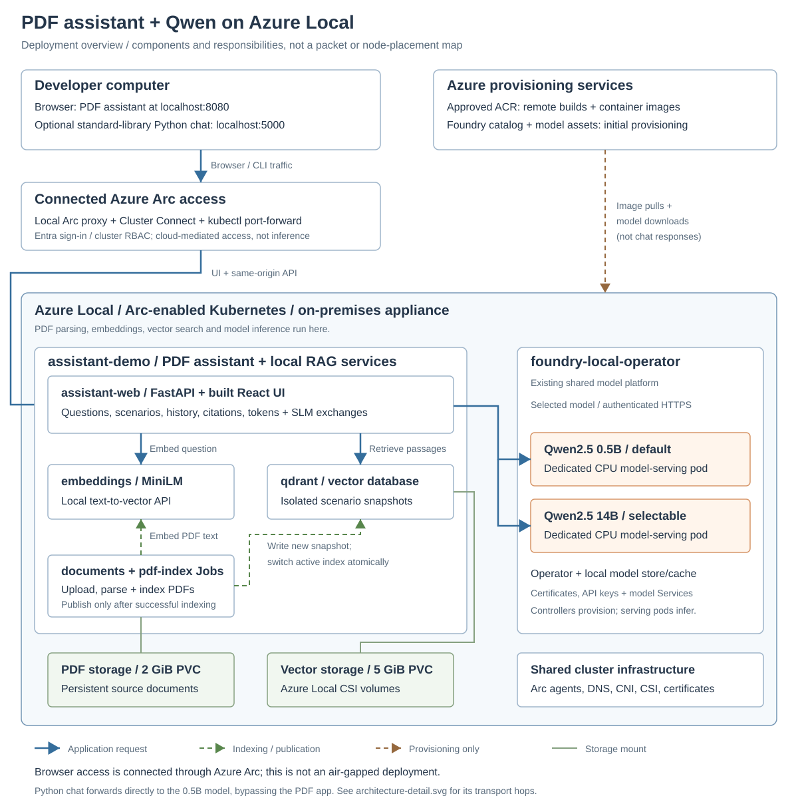

# Architecture: PDF assistant and Qwen on Azure Local

## Deployment overview



[Open the scalable diagram](./architecture.svg) or [download the PNG](./architecture.png).
The overview groups components by responsibility and deployment boundary, like
the [sibling telemetry architecture](https://github.com/MSFT-Innovation-Hub-India/azure-local-telemetry-ai-agent/blob/main/docs/ARCHITECTURE.md#2-deployment-architecture).
It is a logical deployment view, not a map of nodes or transport hops.

| Component group | Responsibility |
|---|---|
| Developer computer and Azure Arc access | Browser UI on `localhost:8080`, or the separate standard-library Python chat on `localhost:5000`, through connected cluster access |
| `assistant-demo` | FastAPI serves React and orchestrates PDF retrieval, scenario/model selection and conversational answers |
| MiniLM embeddings and Qdrant | Embed questions/PDF text and retrieve passages from isolated scenario snapshots; these are not generative models |
| Document helper and indexing Jobs | Upload and parse PDFs, build a new snapshot and publish only after indexing succeeds |
| PDF/vector PVCs | Persist source documents and searchable vectors on Azure Local CSI storage |
| `foundry-local-operator` | Existing Qwen 0.5B and 14B serving pods; operator, model store and trust support them |
| Approved Azure provisioning services | ACR builds/supplies images; catalog/model assets support provisioning, not cloud inference |

Read the overview in three passes:

1. **Ask:** browser -> Arc access -> FastAPI -> embed the question / retrieve
   passages -> selected Qwen model. The answer, sources, tokens and SLM exchange
   return through FastAPI to the same browser.
2. **Index:** upload PDFs -> document PVC -> indexing Job -> MiniLM -> new Qdrant
   snapshot -> atomic active-index switch. Failed indexing keeps the prior index.
3. **Provision:** approved ACR and model sources supply artifacts; runtime parsing,
   embedding, retrieval and inference stay on Azure Local. Arc browser access
   is cloud-mediated, so this is not an air-gapped or wholly on-premises path.

Solid arrows show application requests; dashed arrows separate indexing and
provisioning; lines without arrows show mounts. Secrets remain backend-only.
The diagram omits Kubernetes API/kubelet hops, per-model sidecars, gateway
alternatives and individual platform agents so the primary components remain
readable. Other applications can share embeddings/Qdrant with separately scoped
collections; they are outside this PDF assistant view.

See the [assistant runbook](./docs/ASSISTANT.md#architecture) for executable
deployment/validation and storage details. No cluster configuration is changed
by this documentation update.

## Chunking, embeddings and vector storage

**MiniLM is not part of the Qdrant database, and it does not perform this
application's chunking.** They run as separate components with different jobs:

| Stage | Component in this repository | What it does |
|---|---|---|
| PDF text extraction | `pypdf` in [the indexer](./assistant/indexer.py) | Reads text from each PDF page; unusable/textless PDFs are rejected, not silently OCR'd |
| Chunking | Python `extract_chunks` in the indexer | Normalizes whitespace and splits each page into up to 900-character chunks with 120-character overlap, retaining document/page metadata |
| Embedding / vectorization | `all-MiniLM-L6-v2` through FastEmbed in [the embedding service](./assistant/embeddings.py) | Converts each chunk or question into a 384-dimensional numerical vector |
| Vector storage and retrieval | Qdrant, accessed through [the backend clients](./assistant/clients.py) | Persists vectors with passage text/metadata and searches for similar vectors |
| Answer generation | Selected Foundry Local Qwen model, called by [the assistant service](./assistant/service.py) | Uses retrieved passages and bounded conversation history to generate a grounded answer |

```text
Indexing:
PDF -> pypdf text extraction -> Python chunking -> MiniLM embeddings
    -> Qdrant vectors + passage text + source metadata

Answering:
Question -> MiniLM embedding -> Qdrant similarity search
         -> retrieved passages + question/history -> Qwen -> answer + citations
```

An embedding is a numerical representation used for semantic similarity, not a
generated answer. Qdrant finds relevant passages; Qwen writes the answer from
those passages.

### How PDF chunking works in this application

Chunking is implemented in Python's `extract_chunks` function in
[the indexer](./assistant/indexer.py), before MiniLM receives any text:

1. **Read the PDF page by page.** `pypdf` extracts each page's text. This is text
   extraction, not OCR; encrypted PDFs and PDFs with no usable text are rejected.
2. **Normalize whitespace on each page.** Runs of spaces, tabs and newlines are
   replaced with single spaces using `" ".join(text.split())`.
3. **Take a window of up to 900 characters.** The first chunk starts at the
   beginning of the normalized page text.
4. **Advance by 780 characters.** The next chunk starts at
   `900 - 120 = 780`, so consecutive full chunks share 120 characters. The
   overlap gives neighboring chunks some common context around the boundary.
5. **Stop when the page is covered.** The final chunk can be shorter than 900
   characters. Blank pages contribute no chunks, and chunks never cross pages.
6. **Keep source information with every chunk.** The indexer retains the
   relative document filename, 1-based page number, zero-based chunk number
   within the document, text and document content hash. Each chunk is then
   embedded separately and stored with its metadata in Qdrant.

For example, a normalized page containing 2,000 characters produces:

| Chunk | Character positions (1-based, inclusive) | Length |
|---|---|---|
| First | 1-900 | 900 characters |
| Second | 781-1680 | 900 characters |
| Third | 1561-2000 | 440 characters |

The first and second chunks share positions 781-900; the second and third share
1561-1680. Document/page metadata lets the UI cite the original PDF page when a
chunk is retrieved.

This is **fixed-size character-window chunking**, not sentence-, paragraph- or
semantic-aware splitting. A boundary can fall inside a word or sentence.
The [configuration](./assistant/config.py) defines the 900-character size and
120-character overlap. These are **not token counts**: MiniLM's tokenizer has
its own input limit and may truncate long inputs. MiniLM vectorizes the already
prepared chunks; neither MiniLM nor Qdrant performs this application's splitting.

### Open-source components

- **MiniLM embedding model:** this project uses
  [`sentence-transformers/all-MiniLM-L6-v2`](https://huggingface.co/sentence-transformers/all-MiniLM-L6-v2),
  an English sentence/paragraph embedding model published under Apache 2.0.
  "MiniLM" identifies the model family; it is not a database or PDF parser.
- **FastEmbed:** an [Apache-2.0 Python library maintained by Qdrant](https://github.com/qdrant/fastembed)
  that runs the embedding model using ONNX Runtime. This project provisions a
  pinned [ONNX model snapshot](https://huggingface.co/Qdrant/all-MiniLM-L6-v2-onnx)
  into the embedding image and loads it offline at runtime.
- **Qdrant:** an [Apache-2.0 open-source vector database](https://github.com/qdrant/qdrant).
  A hosted cloud offering also exists, but this deployment uses a local
  StatefulSet and persistent Azure Local storage, not Qdrant Cloud.

FastEmbed and the ONNX model snapshot are maintained under the Qdrant
organization, which can make the names confusing. That does **not** put MiniLM
inside the database: the separate `embeddings` service creates vectors, and the
`qdrant` service stores/searches them.

### Are these platform defaults?

These are **this project's selected defaults**, not required or universal Azure
Local, Foundry Local or RAG defaults. MiniLM/FastEmbed provide lightweight local
CPU embeddings; Qdrant provides persistent vector search and metadata filtering.
The pinned embedding model produces 384-dimensional vectors. The model,
dimensions and chunk settings are defined in
[the application configuration](./assistant/config.py), not selected by Qdrant
or by the user in the UI. The UI's model selector chooses the generative Qwen
model, not the MiniLM embedding model.

## Detailed Python chat transport

The original diagram is preserved as a separate
[editable transport-detail SVG](./architecture-detail.svg) and
[transport-detail PNG](./architecture-detail.png). It covers the standard-library
chat demo's numbered tunnel hops and installed platform components, not the
PDF assistant workflow.

## What actually happens in this demo

The three VS Code terminals run on the **developer's Windows computer**.
The Kubernetes cluster, supporting controllers, model store, and Qwen runtime
run on **Azure Local**, inside the on-premises hardware boundary.

| Step | Component | Action |
|---|---|---|
| 1 | Python `chat.py` | Sends `POST https://localhost:5000/v1/chat/completions`, an `api-key` header, and the conversation's messages. |
| 2 | `kubectl port-forward` | Accepts the local connection. It resolves `svc/qwen2-5-0-5b-cpu` to a pod and translates Service port `5000` to pod target port `8443`. |
| 3 | Local Azure Arc proxy | The kubeconfig points to this process (`localhost:47011` in the supplied session). It connects through Azure Arc Cluster Connect. |
| 4 | `clusterconnect-agent` | Maintains an outbound-established session from the cluster to Azure Arc. Cluster access does not require opening an inbound public Kubernetes API endpoint. |
| 5 | `kube-aad-proxy` and Kubernetes API server | Authenticate cluster access and authorize the Kubernetes operation. The API server carries the port-forward stream. |
| 6 | Worker kubelet / container runtime | Handles the port-forward stream to the selected pod. |
| 7 | Qwen pod's `nginx-sidecar` | Receives the model HTTPS connection on port `8443` and fronts the inference endpoint. |
| 8 | Qwen pod's `inference` container | Runs the Foundry Local CPU serving runtime (`onnx-genai`) with Qwen weights. The response returns through the same tunnel. |

**Important distinction:** port-forwarding to a Service uses it to select a pod
and target port. The forwarded bytes do **not** go through the Service ClusterIP.
The Kubernetes API server participates here because this is a development tunnel,
not the normal in-cluster inference route.

The Python script also uses kubectl to retrieve the API-key Secret and the
resolved model name. Those are Kubernetes API reads, separate from the model's
chat-completion API. Azure/Entra authorization for cluster access and the
per-model API key are different authentication layers.

The model endpoint uses TLS. The demo's `--insecure` option skips server
certificate verification; it does not switch the model request to plaintext.
Use it only for the trusted lab endpoint.

## Where Istio and Envoy fit

The installed deployment also has a gateway route:

```text
In-cluster caller
  -> inference-internal-gateway-istio:443
  -> HTTPRoute prefix /qwen2-5-0-5b-cpu (prefix rewritten to /)
  -> qwen2-5-0-5b-cpu Service:5000
  -> selected model pod:8443
  -> inference container:5000
```

For chat, the gateway request path is
`/qwen2-5-0-5b-cpu/v1/chat/completions`.
The transport-detail diagram's purple route represents this alternative; **the current
`kubectl port-forward svc/qwen2-5-0-5b-cpu ...` demo bypasses the gateway**.
The gateway Service was observed as an internal ClusterIP, not a publicly
exposed endpoint.

- **Gateway API** defines configuration types such as `Gateway` and `HTTPRoute`.
  It is not the Kubernetes API server or a running proxy.
- **Istio's `istiod` pod** runs in `istio-system` and configures the gateway.
- **Envoy** runs in the `istio-proxy` container of the
  `inference-internal-gateway-istio-...` pod in `foundry-local-operator`.
  Its inspected image is `registry.istio.io/release/proxyv2:1.30.8`.
- The Qwen pod has an **NGINX** sidecar, not an observed Envoy sidecar.
  Installing Istio does not mean every pod is part of an injected service mesh.

## Model selection, download, and hosting

1. Browse the local `foundry-local-catalog` ConfigMap. In the supplied lab,
   catalog JSON was compressed in `binaryData.catalog.json.gz`.
2. Select a CPU model variant and use its **asset ID** in `ModelDeployment`.
   The installed operator requires `spec.model.assetId`, not the older
   `model.catalog` structure in the original walkthrough.
3. The operator reconciles the desired deployment, model-store resources,
   serving workload, Service, HTTPRoute, API-key Secret, and certificate resources.
4. The model-store/cache workflow makes model artifacts available locally.
   The serving pod has a `model-store-pull` init container that retrieves assets
   before inference starts.
5. A **separate model-serving pod**, not the operator pod, executes Qwen.
   The model weights and ONNX GenAI runtime are used inside its `inference`
   container; the weights are not themselves a separate pod.

| Setting | This scenario |
|---|---|
| Deployment | `qwen2-5-0-5b-cpu` |
| Namespace | `foundry-local-operator` |
| Model | `qwen2.5-0.5b-instruct-generic-cpu`, version `4` |
| Asset ID | `azureml://registries/azureml/models/qwen2.5-0.5b-instruct-generic-cpu/versions/4` |
| Runtime / compute | `onnx-genai` / CPU |
| Replicas | 1 |
| Requests / limits | 2 CPU / 6 GiB requested; 4 CPU / 10 GiB limits |
| Model file size | 861,939,957 bytes (about 0.80 GiB); not total runtime memory |
| API-key Secret name | `qwen2-5-0-5b-cpu-api-keys` (no key values shown) |

Other catalog entries discussed in the lab include Qwen 1.5B, Phi variants,
and Mistral. Availability and sizes depend on the catalog snapshot. Selecting a
catalog entry does not automatically deploy it.

## Supporting pods and services

| Component | Role |
|---|---|
| `inference-operator` | Controller plus NGINX and a native OTel sidecar; manages model deployments rather than executing model tokens. |
| `inference-operator-model-store` | Local artifact registry with `registry`, `model-store-auth`, and `nginx-sidecar` containers. Model storage is distinct from model execution. |
| `telemetry-collector` | OTel collector with native `msi-adapter`, `mdsd`, and `mdm` sidecars. Collects operational telemetry, not a hop in the inference response path. |
| `catalog-sync-seed` | Completed catalog setup job observed in the supplied transcript; not required to remain running. |
| Model-store auth probe jobs | Completed reader/writer checks in the supplied transcript and live inventory; not model servers. |
| `cert-manager` / `trust-manager` | Installed through the lab's `Microsoft.CertManagement` Arc extension for certificate lifecycle and trust distribution. Exact current pods/namespace were not confirmed by the live inspection. |
| Arc agents | Cluster connectivity, extension installation, configuration, identity, resource synchronization, and telemetry. They run in `azure-arc`. |
| Kubernetes infrastructure | API server, etcd, scheduler, controllers, kubelet/runtime, Cilium networking, DNS, and CSI storage support the workloads. |

Native sidecars can be declared under `initContainers` with
`restartPolicy: Always`. This explains why regular `spec.containers` alone
does not account for all containers in the transcript's `3/3` or `4/4` counts.
Readiness counts are **containers per pod**, not model replicas.

## Boundaries and evidence

- The hardware boundary is conceptual. No appliance vendor, physical host count,
  or exact physical topology was established.
- AKS Arc nodes run on Azure Local infrastructure; this is not Azure-hosted AKS.
  The transcript showed one control-plane node and one worker. The inspected
  application pods were on that worker. That original inventory is historical;
  the PDF assistant and 14B model were added later. Neither diagram is a placement map.
- **Inference compute stays on Azure Local, but this access path uses Azure Arc
  cloud connectivity for the tunnel.** Do not interpret local execution as proof
  that request/response transport never leaves the site. Artifact downloads and
  configured telemetry are also distinct outbound flows.
- No Azure-hosted model inference API or external load balancer is used by this
  Python demo. The registry supplies assets, not chat responses.
- Pod/container names, Qwen init/native sidecars, Service port mappings,
  HTTPRoute, and resolved model settings were inspected live while preparing
  the original transport-detail diagram. Other setup context comes from the supplied transcript and lab.
  Controller reconciliation and cache flows are logical relationships, not a
  packet capture or a complete storage/network implementation inventory.

### References

- [Lab: install Foundry Local](https://docs.almr.adaptivecloudlab.com/eng-22325/foundry-local/deploy-foundry-local.html?tabs=powershell)
- [Lab: deploy a CPU model](https://docs.almr.adaptivecloudlab.com/eng-22325/foundry-local/deploy-model.html?tabs=powershell)
- [Lab: run inference](https://docs.almr.adaptivecloudlab.com/eng-22325/foundry-local/run-inference.html?tabs=powershell)
- [Microsoft Learn: Azure Arc Cluster Connect architecture](https://learn.microsoft.com/en-us/azure/azure-arc/kubernetes/conceptual-cluster-connect)
