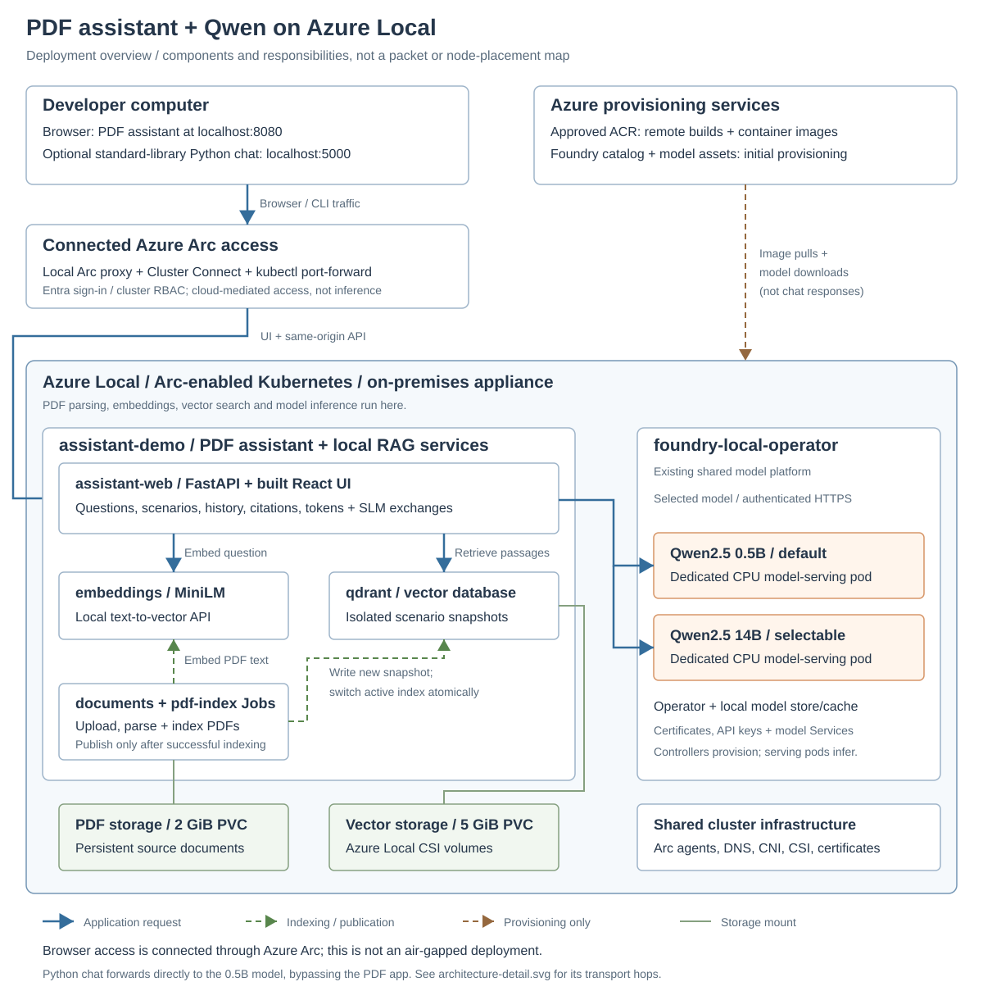

# Sovereign AI assistant on Azure Local

Ask questions about service documents, retrieve the relevant PDF passages, and
get a cited answer from a locally hosted Qwen model. This repository connects
to a **preconfigured Arc-enabled Kubernetes cluster on an Azure Local appliance**
and deploys the PDF assistant alongside the existing model platform.

## What this showcases

1. **AI processing and persistent data on the appliance.** A Python indexer
   extracts/chunks PDFs; MiniLM vectorizes the chunks; Qdrant stores and searches
   them. A custom React/FastAPI app accepts natural-language questions and asks
   the selected Qwen SLM to answer from retrieved evidence. Documents, vectors,
   embeddings and inference stay on Azure Local.
2. **Azure Local as the sovereign workload platform.** Compute, networking and
   storage run on the on-premises appliance. This demo uses Azure Arc in Microsoft
   Azure for connected management/access and an approved Azure Container Registry
   for remote image builds and distribution.
3. **Foundry Local model deployment and hosting.** Its catalog, operator and
   local model store turn a model asset plus a `ModelDeployment` definition into
   a locally hosted inference service: runtime, serving pod, endpoint and model
   credentials. The app uses these services rather than packaging model weights
   into the web application.
4. **Familiar Kubernetes operations through Azure Arc.** The user's
   `az connectedk8s proxy` establishes the connected access path so local
   `kubectl` commands and port-forwards reach the cluster. You use familiar
   Kubernetes tooling, as with AKS or a local cluster, without moving its
   workloads to Azure-hosted AKS.

**CPU-only walkthrough:** only CPU resources were available to this solution in
the lab cluster. It deploys/uses local Qwen2.5 0.5B and 14B CPU models through
Foundry Local across the document scenarios; no GPU is required or used.
The 0.5B model is the default, while 14B offers a comparison for more demanding
questions. Model choice does not remove the need to check retrieved evidence.

**Important boundary:** local processing does not mean fully disconnected
operation or wholly on-premises transport. Browser access and document uploads
use a cloud-mediated Arc tunnel; initial builds/model provisioning need external
connectivity, and platform monitoring can have outbound flows. This demo
illustrates workload/data placement, not a certification of regulatory sovereignty.

### Why ONNX is used here

**ONNX (Open Neural Network Exchange)** is a model format; **ONNX Runtime** is
the engine that executes those models. It supports two parts of this solution:

- **Qwen inference:** Foundry Local's `onnx-genai` runtime runs the selected CPU
  model assets and generates the answer tokens.
- **MiniLM embeddings:** FastEmbed uses ONNX Runtime to turn chunks/questions
  into vectors. The ONNX model is provisioned into the embedding image at build
  time and loaded offline at runtime. Python, not ONNX, does the PDF chunking.

This fits the CPU-only lab and the available Foundry model assets, without
requiring GPUs. Alternatives include **PyTorch** for general-purpose model
execution/training, **llama.cpp** for CPU-friendly GGUF model inference, or
Foundry's **GPU/vLLM** serving path where suitable hardware is available.
ONNX is the compatible CPU deployment choice here, not a claim that it is
universally faster or the only way to run models locally.

## The scenario: field-service warranty support

A Contoso service technician asks about industrial-equipment warranty coverage:
regional differences for India, EMEA and APAC, exclusions, repair warranty, and
goodwill approval limits. The assistant uses a global policy, regional addenda
and an authority matrix to answer with document/page citations.

Try:

- "According to the India addendum, how many months is the warranty coverage period?"
- "According to the goodwill matrix, which role holds Tier 2 approval authority?"
- "How do the India coverage limits compare with the global limits?"

Answers are **advisory**: the app does not approve claims, release payments,
access a claim system or fetch documents referenced by a policy. Missing evidence
must be identified. See the [sample questions and reviewer checkpoints](./scenarios/contoso-field-service/sample-questions.txt).
The definition/prompt are included; PDFs are supplied separately, not committed
or baked into container images. Synthetic operations, manufacturing and retail
examples provide a repeatable first smoke test.

## Walk through the demo

| Order | Follow this page | Outcome |
|---|---|---|
| 1 | [Prerequisites](./docs/PREREQUISITES.md) | Configure Windows tools/sign-in, start the Arc proxy, verify the existing cluster and Foundry platform |
| 2 | [Deploy the components](./docs/DEPLOYMENT.md) | Build in approved ACR, pass the guarded preflight, deploy only `assistant-demo`, verify storage and pods |
| 3 | [Publish documents and a scenario](./docs/SCENARIOS.md#first-demo-operations-or-contoso) | Chunk/vectorize PDFs on Azure Local and atomically publish a searchable scenario |
| 4 | [Select, ask and inspect](./docs/SCENARIOS.md#4-select-and-demonstrate) | Ask questions, check citations, compare Qwen models and inspect SLM exchanges |

**Already deployed?** Keep the Arc proxy running in terminal 1:

```powershell
az connectedk8s proxy --resource-group zines-22325-rg --name zines-22325-aks
```

In terminal 2, forward only the application endpoint:

```powershell
kubectl --context zines-22325-aks port-forward -n assistant-demo `
    svc/assistant-web --address 127.0.0.1 8080:80
```

Open **http://localhost:8080**, choose **Contoso Field Service** if published, and
ask a sample question. Start with **Operations guide** for the synthetic recovery
code test. Expand sources and **SLM request and response** below the answer.
Token counts are model-reported; absent counts are labeled unavailable.
Switching scenario/model starts a fresh displayed conversation. Ctrl+C stops
the local tunnels, not the workloads.

## Understand the solution



| Topic | Focused documentation |
|---|---|
| Platform and model setup | [Windows workstation](./docs/PREREQUISITES.md#a-configure-the-developer-workstation) / [Foundry Local](./docs/PREREQUISITES.md#b6-platform-administrator-only-foundry-local-extension) / [Qwen CPU models](./docs/PREREQUISITES.md#b8-platform-administrator-only-deploy-the-qwen-cpu-models) |
| Overall architecture | [Overview](./ARCHITECTURE.md#deployment-overview) / [Existing versus added components](./ARCHITECTURE.md#existing-platform-versus-added-application) / [Pods and containers](./ARCHITECTURE.md#pods-and-containers) / [Volumes](./ARCHITECTURE.md#volumes-and-configuration) |
| Arc connectivity and security | [Outbound connection](./docs/CONNECTIVITY.md#1-cluster-access-an-outbound-established-two-way-channel) / [Authentication and authorization](./docs/CONNECTIVITY.md#authentication-is-necessary-but-authorization-is-separate) |
| Browser access | [Port-forward flow](./docs/CONNECTIVITY.md#2-application-access-browser-http-over-kubectl-port-forward) / [Application-access diagram](./docs/CONNECTIVITY.md#browser-to-application-architecture) / [Private production access](./docs/CONNECTIVITY.md#3-demo-access-versus-a-private-production-design) |
| Chunking and vector search | [Python chunking, MiniLM/FastEmbed, Qdrant and Qwen roles](./ARCHITECTURE.md#chunking-embeddings-and-vector-storage) |
| Shared engine and new scenarios | [Shared services](./docs/SCENARIOS.md#what-stays-shared) / [Create a scenario](./docs/SCENARIOS.md#1-create-a-scenario) / [Publish it](./docs/SCENARIOS.md#3-publish-to-the-existing-cluster) |
| Images, Dockerfile and YAML | [Packaging](./docs/DEPLOYMENT.md#what-is-packaged) / [Guarded deployment](./docs/DEPLOYMENT.md#4-preflight-then-deploy-the-assistant) |
| Code and runtime pipelines | [Code map](./docs/DEVELOPMENT.md#code-map) / [Indexing](./docs/DEVELOPMENT.md#pipeline-1-ingest-and-index-a-content-release) / [Question/answer flow](./docs/DEVELOPMENT.md#pipeline-2-answer-a-question) |
| Testing | [Test coverage and commands](./docs/DEVELOPMENT.md#testing) / [Recorded lab validation](./docs/ASSISTANT.md#validation-record) |
| Detailed operations and recovery | [Runbook](./docs/ASSISTANT.md) / [Core upgrades](./docs/ASSISTANT.md#subsequent-core-upgrades-rebuild-only-the-application) / [Safe recovery](./docs/DEPLOYMENT.md#safe-recovery) |
| Original standard-library chat | [Run the chat](./docs/CHAT.md#run-with-three-terminals) / [Detailed model transport](./docs/CHAT.md#detailed-model-transport) |

## Keep the lab safe

- Reuse existing Arc, networks, Foundry and model resources. Application writes
  are additive and confined to `assistant-demo`.
- Do not lower resource requests, scale infrastructure or use control-plane
  taints to fit the demo. Stop on insufficient capacity and ask the lab owner.
- Credentials stay backend-only. Do not commit keys, tenant/subscription IDs,
  kubeconfigs or private PDFs. Refresh expiring ACR pull credentials before pulls.
- Failed indexing keeps the previous searchable snapshot. Retain PVCs for recovery.
- Scenario isolation is **not authorization**: all users who can reach this demo
  can select published scenarios. Production needs user/document access controls.

Based on the [Azure Local Foundry lab](https://docs.almr.adaptivecloudlab.com/eng-22325/foundry-local/index.html).
No local Docker is required; image builds use **`az acr build`**.
