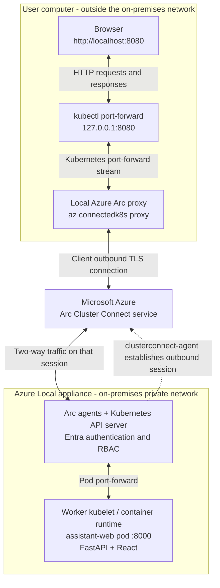

# Connected access: Azure Arc, kubectl and the browser

The Kubernetes cluster runs inside the **physically on-premises Azure Local
appliance**. Registering it with Azure Arc gives it an Azure management identity;
it does not move its API server, worker nodes or applications into Azure.
This guide separates **cluster administration** from **accessing the app**.

## 1. Cluster access: an outbound-established, two-way channel

[Microsoft's Cluster Connect architecture](https://learn.microsoft.com/azure/azure-arc/kubernetes/conceptual-cluster-connect)
uses a reverse connection, not a public Kubernetes API endpoint:

1. The cluster's **`clusterconnect-agent`** establishes a session **outbound**
   to the Azure Arc service. It is part of the Arc agents installed during
   cluster onboarding, already present in this lab.
2. On the user's computer, **`az connectedk8s proxy`** starts a local Azure Arc
   proxy process using the signed-in caller's Azure identity and target cluster.
   It obtains/merges a kubeconfig whose API-server URL points to that local proxy.
3. `kubectl` reads this kubeconfig and sends Kubernetes requests to the local
   proxy, which connects outward to Azure Arc. Azure routes the requests onto
   the cluster's outbound-established session.
4. In the cluster, `clusterconnect-agent` forwards the request to
   **`kube-aad-proxy`**, which verifies the Microsoft Entra identity and forwards
   it to the API server using Kubernetes user impersonation. Authorization then
   determines which operations that identity may perform.
5. Responses return through the connected path. **Outbound initiation does not
   mean one-way traffic**: the established connection carries requests and
   responses without opening an inbound Internet port on the appliance firewall.

The client reaches Azure endpoints over the public Internet in this demo; it
does **not** directly dial the appliance's private API-server address.
The [network requirements](https://learn.microsoft.com/azure/azure-arc/kubernetes/network-requirements)
still require approved outbound endpoints and TLS connectivity, generally
port 443, including WebSocket support for the Cluster Connect service-bus
endpoints. Additional requirements depend on enabled features, such as Azure
RBAC. "No inbound rule needed" is not "no firewall configuration needed."

### Which prerequisite components enable this?

| Component | Where it runs | Relationship to this connection |
|---|---|---|
| [`connectedk8s` CLI extension](PREREQUISITES.md#a4-install-azure-cli-extensions) | User computer | Supplies `az connectedk8s proxy` and starts the client-side proxy |
| Arc agents, including `clusterconnect-agent` and `kube-aad-proxy` | Cluster, under the existing Arc installation | Reverse connectivity and Entra authentication; not installed by the assistant |
| Foundry / certificate-management extensions; Istio | Cluster | Model serving, certificates and model routing, **not** the Arc access tunnel |

The `k8s-extension` CLI extension manages cluster extensions; it is not the
client-side tunnel. No new Arc onboarding or extension installation is needed
on this already connected lab.

### Set the context, then use normal kubectl commands

After [sign-in/subscription selection](PREREQUISITES.md#a2-sign-in-to-the-tenant-containing-the-lab),
keep terminal 1 running:

```powershell
az connectedk8s proxy --resource-group zines-22325-rg --name zines-22325-aks
```

In terminal 2, verify the context and optionally make it the local default:

```powershell
kubectl config get-contexts
kubectl config use-context zines-22325-aks
if ($LASTEXITCODE -ne 0) { throw "Cluster context selection failed." }
kubectl config current-context
kubectl get pods -n assistant-demo
```

Context selection changes local kubeconfig, not the remote cluster. The lab
proxy merges into `$HOME\.kube\config`; verify the file/context if you use a
custom `KUBECONFIG`. The familiar get/describe/apply commands now use the remote
cluster through the proxy. Our deployment examples keep `--context` explicit
to avoid accidentally targeting another cluster. Never commit kubeconfig.

### Authentication is necessary, but authorization is separate

- The lab uses **Microsoft Entra sign-in**, not anonymous access. The caller
  needs Azure/Arc connection permissions and permission for the requested
  Kubernetes operation; `az login` alone is insufficient.
- The API server enforces **native Kubernetes RBAC**, or **Azure RBAC for
  Kubernetes when configured**. Do not assume every authenticated user is an
  administrator. An authorized owner grants the minimum required access.
- Port-forwarding needs access to its target and the **`pods/portforward`**
  subresource. These permissions can give direct workload access and may bypass
  network-level controls; restrict them rather than relying only on NetworkPolicy.
- Azure network legs use TLS; the API server need not be publicly exposed.
  These are useful safeguards, not a guarantee of safety regardless of identity,
  device, permissions or application configuration.

The browser does not authenticate to Arc independently: it uses a tunnel already
opened by the authorized workstation user. This is **not application-level
user/document authorization**; the demo lets anyone who can reach its HTTP
endpoint select published scenarios.

## 2. Application access: browser HTTP over kubectl port-forward

Cluster connectivity alone does not make the app appear on localhost. With
terminal 1's Arc proxy still running, start the application forward in terminal 2:

```powershell
kubectl --context zines-22325-aks port-forward -n assistant-demo `
    svc/assistant-web --address 127.0.0.1 8080:80
```

Wait for `Forwarding from 127.0.0.1:8080`, then open **http://localhost:8080**:

1. The browser sends HTTP to the workstation's loopback port 8080.
2. `kubectl` uses Service `assistant-web` to select a pod and resolve
   **Service port 80 -> pod port 8000**, as defined in [stack.yaml](../deploy/stack.yaml).
3. It opens an authorized Kubernetes port-forward stream through the local Arc
   proxy, Azure Arc, cluster agents and API server to the worker's
   kubelet/container runtime and the selected pod.
4. FastAPI serves React and same-origin API requests. Retrieval/inference stay
   on the appliance; HTTP response bytes return through the same forwarding
   path to the browser. This transport stream is not streaming model generation.

**The Service selects the destination; forwarded bytes do not traverse its
ClusterIP.** No public application ingress, LoadBalancer or appliance inbound
port is created. Loopback-only binding avoids exposing port 8080 to other
machines, but local processes/users can still reach it while the tunnel runs.

### Browser-to-application architecture



**Dotted arrow:** connection initiated from the cluster. **Two-headed arrows:**
request/response traffic, not new inbound firewall connections. Service selection
and the individual cluster-side processes are explained above; the diagram groups
them to keep the browser path readable.
The cloud relay is why browser requests, uploads and answers take an Azure-
mediated path even though PDF processing, storage and inference remain local.

Keep both terminal processes running. `Ctrl+C` stops only the relevant local
proxy/forward, not the deployed app. If the selected pod restarts, restart the
port-forward; if Arc connectivity fails, re-establish the proxy first.

## 3. Demo access versus a private production design

This demo deliberately demonstrates authorized workstation access through
public-internet Azure endpoints; the walkthrough does not impose a
private-network-only client policy. It is **not** an anonymous Internet-facing
application. Actual access remains subject to the lab's identity, network and
RBAC policies; this document is not a policy audit.

For the production scenario described here, keep application users on the
corporate/private network or an approved VPN, and provide a **private application
endpoint with TLS and user/document authorization**, rather than issuing
kubectl credentials and port-forwards to end users. Public-internet client
access is then unnecessary and can be restricted under the owner's approved
access policy.

Arc can remain for connected management. Simply moving a client onto the private
network does **not** make `az connectedk8s proxy` an entirely on-premises path:
it still uses Azure Cluster Connect. Direct private API/app access is a separate
network/access design, and Arc's outbound management requirements still apply
if retained. None of these production changes are performed by this walkthrough.

## Official references

- [Microsoft: Cluster Connect architecture](https://learn.microsoft.com/azure/azure-arc/kubernetes/conceptual-cluster-connect)
- [Microsoft: Cluster Connect authentication and access setup](https://learn.microsoft.com/azure/azure-arc/kubernetes/cluster-connect)
- [Microsoft: Arc network requirements](https://learn.microsoft.com/azure/azure-arc/kubernetes/network-requirements)
- [Microsoft: `az connectedk8s proxy` reference](https://learn.microsoft.com/cli/azure/connectedk8s#az-connectedk8s-proxy)
- [Kubernetes: port-forwarding and authorization](https://kubernetes.io/docs/tasks/access-application-cluster/port-forward-access-application-cluster/)
