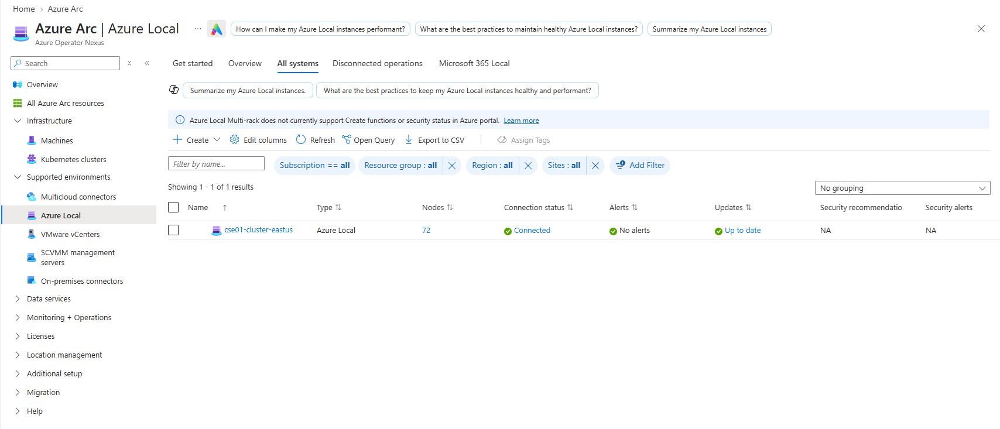
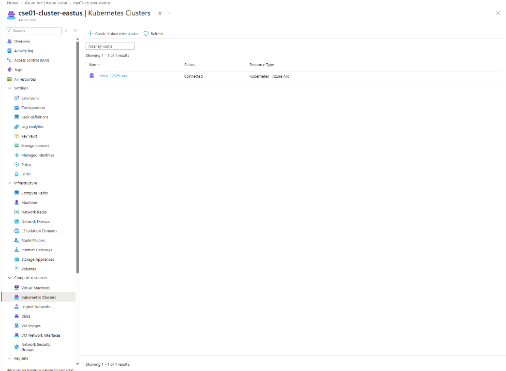
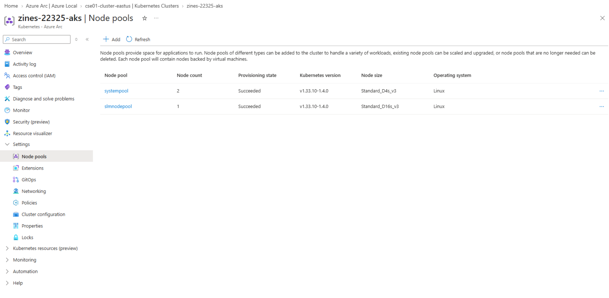
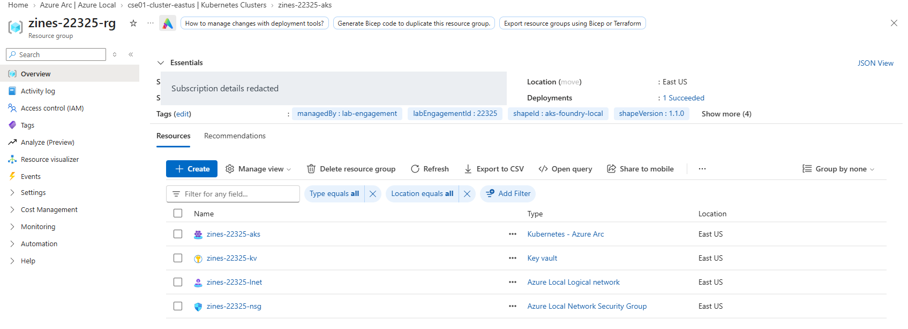
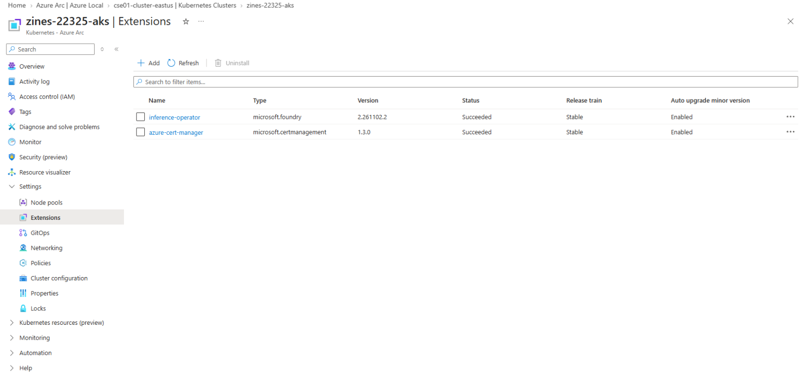

# Prerequisites: workstation, Azure Arc access and Foundry Local

This guide prepares a Windows developer workstation and explains the platform
prerequisites for the PDF assistant and standard-library Qwen chat demos.
It precedes the [short deployment walkthrough](DEPLOYMENT.md) and
[scenario publication guide](SCENARIOS.md).

**Reading route:** [workstation](#a-configure-the-developer-workstation) ->
[Arc access and platform checks](#b-connect-to-the-cluster-and-verifyinstall-the-platform) ->
[Qwen model deployment](#b8-platform-administrator-only-deploy-the-qwen-cpu-models) ->
[readiness checklist](#c-ready-to-configure-the-demo) ->
[deploy the application](DEPLOYMENT.md). On an already configured lab, skip
platform-installation steps B4-B6; keep them as reference for an approved new setup.

**This is documentation, not an instruction to reconfigure the existing lab.**
The cluster, Foundry extensions and Qwen models in the screenshots are already
deployed. On that cluster, use the read-only verification steps and skip
installation of existing resources. Platform installation in Part B requires
explicit lab-owner/platform-admin approval; assistant deployment is confined to
`assistant-demo`.

## Before starting

- An Azure Local appliance and an Arc-enabled Kubernetes cluster must already
  exist and be connected. This guide does not create the appliance, cluster,
  networks, node pools, identities or resource groups.
- Obtain the tenant, subscription, resource group and Arc cluster name from the
  lab owner. You need authorization for Arc Cluster Connect and Kubernetes
  operations. Signing in to Azure does not itself grant cluster-admin access.
- Extension installation needs appropriate Azure permissions and platform
  approval; Gateway API/Istio installation needs cluster-scoped Kubernetes
  permissions. Do not assign yourself roles or bypass authorization failures.
- Use Windows PowerShell and separate terminals in VS Code. Installation may
  need local administrator approval. Reopen terminals after tools update PATH.
- Internet access is needed for workstation tools, sign-in, connected Arc access,
  initial image/model provisioning and Helm/manifest downloads. Runtime PDF
  processing and inference run on Azure Local, but the Arc tunnel is
  cloud-mediated: this is not an air-gapped access path.
- Use placeholders below for tenant/subscription IDs. Do not commit identifiers,
  kubeconfigs, credentials or private documents. The resource-group screenshot
  included here has its subscription details redacted.

## Portal orientation: appliance -> cluster -> pools -> nodes

1. In the Azure portal, select the intended subscription and open
   **Azure Arc -> Azure Local -> All systems**. Find the appliance and check its
   connection status.

   

   The appliance's displayed **Nodes** count is not the Kubernetes worker count.
   It describes the Azure Local system; inspect the Kubernetes cluster separately.

2. Open the appliance, then **Kubernetes Clusters**. In this lab, the existing
   Arc-enabled Kubernetes cluster is `zines-22325-aks`.

   

3. Open the cluster and **Node pools**. A node pool groups Kubernetes nodes
   backed by virtual machines with a configured size. Select a pool to inspect
   its nodes; use `kubectl get nodes -o wide` in Part B to verify actual readiness.

   

   **Historical sequence:** the environment initially had one worker under
   `systempool`, in addition to its control-plane node. The initial 0.5B Qwen
   model ran on that worker. The lab owner later added a second `systempool`
   worker because the PDF assistant's capacity preflight found insufficient
   unreserved memory alongside the existing model/platform workloads. It was
   not an automatic prerequisite that the 0.5B model always needs two workers.
   See the [recorded capacity checks](ASSISTANT.md#status-and-safety-boundary).

   For the larger Qwen2.5 14B CPU model, the lab owner added a separate
   `slmnodepool` with a higher configuration: one `Standard_D16s_v3` worker,
   compared with `Standard_D4s_v3` for `systempool`. Larger model weights and
   runtime memory/compute requirements motivated this separate pool.
   **Image 3 is the later state**, showing two `systempool` workers and one
   `slmnodepool` worker, not the original single-worker configuration.

   SKU names are not a substitute for node-reported allocatable resources.
   Do not scale pools, reduce baseline requests or schedule on the control plane
   to make a demo fit; report insufficient capacity and ask the lab owner.

4. Confirm the cluster's resource group and existing resources. The example
   group is `zines-22325-rg`; its key vault, logical network and security group
   are platform resources, not resources this demo creates or replaces.

   

## A. Configure the developer workstation

### A1. Install or update Azure CLI

Check whether Azure CLI is already installed:

```powershell
az --version
```

If it is missing, choose **one** installation method:

```powershell
# Recommended: Windows Package Manager.
winget install -e --id Microsoft.AzureCLI

# Alternative: open the official MSI download, then run the downloaded installer.
Start-Process "https://aka.ms/installazurecliwindows"
```

Finish the installer and reopen PowerShell. To update an existing installation
on a workstation you administer:

```powershell
winget upgrade -e --id Microsoft.AzureCLI
az --version
```

Check the [official Windows installation guide](https://learn.microsoft.com/cli/azure/install-azure-cli-windows)
for the latest available release. **Azure CLI 2.93.0 was the version used when
this environment was configured**; that is historical evidence, not a claim
that it will remain the latest version. If winget reports no update, confirm
the installed version against the official release information.

On a shared or already validated workstation, coordinate upgrades first.
An Azure CLI upgrade can change its bundled Python and extension compatibility;
do not indiscriminately replace a working toolchain while diagnosing connectivity.

### A2. Sign in to the tenant containing the lab

Replace these values with the lab owner's supplied identifiers; keep them out
of source control:

```powershell
$tenantId = Read-Host "Tenant ID containing the Azure Local lab"
$subscriptionId = Read-Host "Subscription ID containing the Arc cluster"
$resourceGroup = "zines-22325-rg"   # Replace for another environment.
$clusterName = "zines-22325-aks"    # Replace for another environment.

az login --tenant $tenantId
if ($LASTEXITCODE -ne 0) { throw "Azure sign-in failed." }
```

Complete browser sign-in with the authorized identity. This signs in to the
tenant; the next step explicitly chooses the subscription containing the Arc
cluster. An ACR in another approved subscription uses a separate sign-in profile
later, as documented in the assistant runbook.

### A3. Select and verify the subscription

```powershell
az account show --output table
az account list --output table
az account set --subscription $subscriptionId
if ($LASTEXITCODE -ne 0) { throw "Cannot select the lab subscription." }
az account show --output table
```

Confirm the account and selected subscription match the portal containing your
Azure Local appliance and Arc cluster. Do not paste account output into commits
or public screenshots. Subscription selection does not create or modify the lab.

### A4. Install Azure CLI extensions

Azure CLI extensions add command groups to the **workstation**. They are distinct
from the **cluster extensions** installed in Part B.

| Extension | Purpose | Needed for this workflow? |
|---|---|---|
| `connectedk8s` | Arc cluster management and proxying kubectl traffic | Yes, for cluster access |
| `k8s-extension` | Manage extensions on Kubernetes clusters | Yes, for approved platform extension installation |
| `aksarc` | Manage AKS Arc clusters on Azure Local | Broader lab administration |
| `stack-hci-vm` | Manage Azure Local virtual machines and networking | Broader lab administration |
| `networkcloud` | Manage Azure Operator Nexus network cloud resources | Optional; not used by PDF assistant deployment |
| `k8s-configuration` | Manage Kubernetes cluster configurations | Optional configuration/GitOps administration |
| `managednetworkfabric` | Manage Azure network fabric resources | Optional; not used by PDF assistant deployment |
| `connectedmachine` | Manage Azure Arc-enabled servers | Optional server administration |
| `customlocation` | Manage Azure Arc custom locations | Optional platform administration |
| `ssh` | SSH into Arc-enabled servers and Azure VMs | Optional; not required for this demo |

Inspect existing versions first:

```powershell
az extension list --output table
```

For a **fresh or approved-to-update workstation**, install/update the two
extensions used by this guide:

```powershell
az extension add --name connectedk8s --upgrade
if ($LASTEXITCODE -ne 0) { throw "connectedk8s installation failed." }
az extension add --name k8s-extension --upgrade
if ($LASTEXITCODE -ne 0) { throw "k8s-extension installation failed." }
```

The following additional commands reproduce the broader lab-management toolset.
They are **optional**, not requirements for the PDF assistant. Run only the
ones appropriate to your authorized work:

```powershell
az extension add --name aksarc --upgrade
az extension add --name stack-hci-vm --upgrade
az extension add --name networkcloud --upgrade
az extension add --name k8s-configuration --upgrade
az extension add --name managednetworkfabric --upgrade
az extension add --name connectedmachine --upgrade
az extension add --name customlocation --upgrade
az extension add --name ssh --upgrade
```

Check `$LASTEXITCODE` after each command and stop on failure. `--upgrade` requests
the newest extension available through Azure CLI if it is already installed.
It does **not** guarantee that the combined extension/native-Python dependencies
are compatible. Preserve working versions when repairing an existing setup;
see [troubleshooting](#troubleshooting-without-changing-the-lab).

### A5. Install kubectl and verify the workstation

If `kubectl` is not already on PATH:

```powershell
winget install -e --id Kubernetes.kubectl
# Reopen PowerShell after installation.
```

Use a kubectl version supported by the target cluster, rather than assuming the
newest client is compatible with every cluster version.

```powershell
az --version
az account show --output table
az extension list --output table
kubectl version --client
az connectedk8s proxy --help
az k8s-extension create --help
```

Each command must complete successfully. Part A is complete when the CLI imports
and command help work, the intended subscription is selected, and kubectl is
available. This alone does not prove cluster connectivity; verify that in Part B.

## B. Connect to the cluster and verify/install the platform

`az connectedk8s proxy` lets the user's local computer interact with the
Azure Arc-enabled Kubernetes cluster running inside the Azure Local appliance.
It establishes the connected Azure Arc access path used by local `kubectl`
commands and port-forwarding. The cluster and its workloads remain on the
appliance; the proxy runs on the user's computer, and access is cloud-mediated
through Azure Arc.

See [the connectivity architecture](CONNECTIVITY.md) for the outbound cluster
session, Entra/RBAC checks and the browser's separate port-forward path.

### B1. Terminal 1: start the Azure Arc proxy

In a new PowerShell terminal, ensure the correct subscription is selected,
then start the proxy:

```powershell
az connectedk8s proxy `
    --resource-group zines-22325-rg `
    --name zines-22325-aks
```

Replace names for another environment. The lab workflow merges the cluster
context into the default kubeconfig at `$HOME\.kube\config` and keeps the proxy
in the foreground until **Ctrl+C**. If you use `KUBECONFIG` or another context
setup, confirm which file/context is in use; do not overwrite unrelated contexts
or commit the file.

Wait for the proxy to report connected/listening, commonly around 10-20 seconds
but potentially longer. **Leave terminal 1 running.** Execute kubectl commands
from a separate terminal.

### B2. Terminal 2: verify access, nodes and existing platform resources

```powershell
kubectl config current-context
kubectl --context zines-22325-aks get nodes -o wide
kubectl --context zines-22325-aks get pods -A
kubectl --context zines-22325-aks get storageclass
az k8s-extension list `
    --cluster-name zines-22325-aks `
    --resource-group zines-22325-rg `
    --cluster-type connectedClusters `
    --output table
helm list --all-namespaces
```

If Helm is missing, install it in B3 before the last command. Check every command
for errors before continuing. Use the explicit context for subsequent kubectl
commands to avoid applying to another cluster.

The initial lab had **one control plane + one worker Ready**. After the recorded
pool additions, expect one control plane and three workers, subject to the lab
owner's current configuration. Check readiness rather than copying an old count.
Long-running pods should be Running **and Ready**; successful one-off Jobs can
be Completed. The lab walkthrough describes one Pending `cilium-operator`
replica in its initial single-control-plane topology. Do not treat arbitrary
Pending pods as healthy: inspect the specific pod's scheduling reason and confirm
that exception with the platform owner.

Before any platform installation, inspect:

```powershell
kubectl --context zines-22325-aks get gatewayclass
kubectl --context zines-22325-aks get crd | Select-String -Pattern "gateway|foundrylocal"
kubectl --context zines-22325-aks get pods -n foundry-local-operator
```

Existing healthy Gateway API/Istio/certificate/Foundry resources should be reused.
**Do not rerun B4-B6 against the configured lab as a repair strategy.**

### B3. Install the Helm CLI

Helm is a workstation tool used to install the Istio Gateway API provider:

```powershell
winget install --id Helm.Helm -e
# Close and reopen terminal 2 so helm is on PATH.
helm version
```

Reopening terminal 2 does not stop terminal 1's Arc proxy. Check your account
and context again after reopening.

### B4. Platform administrator only: Gateway API CRDs, then Istio

**Run only on a new, approved platform where these resources are absent.**
CRDs are cluster-scoped. These commands are not confined to `assistant-demo`
and are not part of the assistant's additive deployment script.

The lab walkthrough installed Gateway API standard CRDs `v1.4.0` and Inference
Extension CRDs `v1.5.0` **before** `istiod`. Verify these versions against the
approved Foundry/Istio compatibility requirements before installation; they are
the lab recipe, not a blanket recommendation for every future cluster.

Downloads need access to GitHub and the Istio chart repository; cluster image
pulls use the lab's permitted egress path. Do not change registry/network rules.

```powershell
kubectl --context zines-22325-aks apply --server-side -f `
    https://github.com/kubernetes-sigs/gateway-api/releases/download/v1.4.0/standard-install.yaml
if ($LASTEXITCODE -ne 0) { throw "Gateway API CRD installation failed." }

kubectl --context zines-22325-aks apply --server-side -f `
    https://github.com/kubernetes-sigs/gateway-api-inference-extension/releases/download/v1.5.0/manifests.yaml
if ($LASTEXITCODE -ne 0) { throw "Inference Extension CRD installation failed." }

helm repo add istio https://istio-release.storage.googleapis.com/charts
if ($LASTEXITCODE -ne 0) { throw "Cannot add Istio chart repository." }
helm repo update
if ($LASTEXITCODE -ne 0) { throw "Helm repository refresh failed." }
helm search repo istio/istiod --versions

# Obtain the approved compatible chart version from the platform owner.
$istioVersion = Read-Host "Approved Istio chart version for this Foundry deployment"
if (-not $istioVersion) { throw "An approved chart version is required." }

helm install istio-base istio/base `
    --kube-context zines-22325-aks --version $istioVersion `
    -n istio-system --create-namespace --wait
if ($LASTEXITCODE -ne 0) { throw "Istio base installation failed." }

helm install istiod istio/istiod `
    --kube-context zines-22325-aks --version $istioVersion `
    -n istio-system `
    --set pilot.env.ENABLE_GATEWAY_API_INFERENCE_EXTENSION=true `
    --wait
if ($LASTEXITCODE -ne 0) { throw "istiod installation failed." }

kubectl --context zines-22325-aks get gatewayclass istio
```

Expected: the `istio` GatewayClass reports **Accepted=True**, with controller
`istio.io/gateway-controller`. Inspect conditions if it does not; do not
automatically uninstall/reinstall shared Istio resources.

### B5. Platform administrator only: certificate-management extension

Foundry Local uses cert-manager and trust-manager for certificate lifecycle and
trust distribution. On an approved new cluster **without** this extension:

```powershell
az k8s-extension create `
    --cluster-name zines-22325-aks `
    --resource-group zines-22325-rg `
    --name azure-cert-manager `
    --cluster-type connectedClusters `
    --extension-type Microsoft.CertManagement `
    --scope cluster `
    --release-train stable `
    --config config.enableGatewayAPI=true `
    --config cert-manager.crds.keep=true `
    --config trust-manager.defaultPackage.enabled=false `
    --config trust-manager.secretTargets.enabled=true `
    --config trust-manager.secretTargets.authorizedSecretsAll=true
if ($LASTEXITCODE -ne 0) { throw "Certificate-management extension creation failed." }

az k8s-extension show `
    --cluster-name zines-22325-aks --resource-group zines-22325-rg `
    --cluster-type connectedClusters --name azure-cert-manager `
    --query "{name:name,state:provisioningState}" --output table
```

Wait until `provisioningState` is **Succeeded**; repeat the read-only `show`
command if provisioning is still in progress. The lab configuration authorizes
trust-manager Secret targets cluster-wide; the platform administrator must review
this scope before adopting it elsewhere. Do not modify existing trust resources
or export certificate/private-key Secrets.

### B6. Platform administrator only: Foundry Local extension

Reference: [Lab: install Foundry Local](https://docs.almr.adaptivecloudlab.com/eng-22325/foundry-local/deploy-foundry-local.html?tabs=powershell).

Install the inference operator only where it is absent and approved. The lab
used `entraAuth.enabled=false`: model inference uses per-model API keys rather
than Entra JWT authentication. Cluster access still uses Entra/RBAC; these are
different authentication layers. Do not disable authentication on an existing
deployment or expose model keys to the browser.

```powershell
az k8s-extension create `
    --cluster-name zines-22325-aks `
    --resource-group zines-22325-rg `
    --name inference-operator `
    --cluster-type connectedClusters `
    --extension-type Microsoft.Foundry `
    --scope cluster `
    --release-namespace foundry-local-operator `
    --auto-upgrade-minor-version true `
    --release-train stable `
    --config entraAuth.enabled=false
if ($LASTEXITCODE -ne 0) { throw "Foundry extension creation failed." }

az k8s-extension show `
    --cluster-name zines-22325-aks --resource-group zines-22325-rg `
    --cluster-type connectedClusters --name inference-operator `
    --query "{name:name,state:provisioningState}" --output table
```

**Capacity and historical cache-job settings:** the lab recipe reports cache-job
defaults of 16 GiB memory request / 32 GiB limit, and used 4 GiB / 8 GiB
overrides during its initial setup. Those historical overrides are **not**
included in the commands above: do not lower baseline resource requests to make
a demo fit. Check the selected extension's actual resource requirements and
available worker reservations **before** installation. If insufficient, stop and
request the lab owner's approved capacity plan. Do not use control-plane taints,
scale other workloads or change the existing extension to work around capacity.

The stable train and automatic minor upgrades reproduce the lab's update policy,
not a version-pinning guarantee. The platform owner must approve that policy.
Extension installation can take several minutes; wait for **Succeeded** before
continuing.

### B7. Verify both extensions and the operator

```powershell
az k8s-extension list `
    --cluster-name zines-22325-aks --resource-group zines-22325-rg `
    --cluster-type connectedClusters --output table
kubectl --context zines-22325-aks get pods -n foundry-local-operator
kubectl --context zines-22325-aks get crd | Select-String -Pattern foundry
kubectl --context zines-22325-aks get gatewayclass istio
```

Both Azure extensions should report **Succeeded**. Long-running operator pods
must be **Running and Ready**; successful cache/probe Jobs may be Completed.
Verify the `foundrylocal.azure.com` CRDs, including `ModelDeployment`, and
`GatewayClass` acceptance. Operator readiness does not itself mean a Qwen model
has been deployed.



Image 5 is the portal's **cluster -> Extensions** view after both installations.
It records Foundry `2.261102.2` and certificate management `1.3.0`, with stable
release trains and automatic minor upgrades enabled. These are screenshot
versions, not instructions to downgrade or replace current working extensions.

### B8. Platform administrator only: deploy the Qwen CPU models

Installing Foundry Local installs the operator, **not a serving model**.
Next comes [Lab: deploy a CPU model](https://docs.almr.adaptivecloudlab.com/eng-22325/foundry-local/deploy-model.html?tabs=powershell).
That guide demonstrates **Phi-4-mini**; this repository instead deployed
**Qwen2.5 0.5B**, followed by **Qwen2.5 14B** (not 15B).

Both use `compute: cpu`, `runtime: onnx-genai`, one replica and pinned model
asset version **4**, rather than the lab guide's Phi catalog entry with `latest`.
No GPU is used. The checked-in YAML is the model configuration; Foundry downloads
and caches the selected artifacts, then creates the serving workload and endpoint.
Initial downloads need the approved outbound provisioning path; inference runs
on Azure Local.

| Model / manifest | ModelDeployment name | CPU / memory request | CPU / memory limit | Placement in this lab |
|---|---|---|---|---|
| [Qwen2.5 0.5B](../deploy/qwen2.5-0.5b.yaml) | `qwen2-5-0-5b-cpu` | 2 CPU / 6 GiB | 4 CPU / 10 GiB | Originally on a `systempool` worker; manifest has no node selector |
| [Qwen2.5 14B](../deploy/qwen2.5-14b.yaml) | `qwen2-5-14b-cpu` | 8 CPU / 16 GiB | 16 CPU / 32 GiB | Explicitly pinned to the higher-configured `slmnodepool` |

**1. Verify before creating anything.** Keep the Arc proxy running in terminal 1;
use terminal 2 from the repository root:

```powershell
kubectl --context zines-22325-aks get modeldeployments -n foundry-local-operator
kubectl --context zines-22325-aks get nodes -L kubernetes.azure.com/agentpool
kubectl --context zines-22325-aks describe nodes
```

The existing lab already has both models: **skip creation and verify readiness**.
For an approved new setup, the platform owner must check allocatable resources,
existing reservations and cache/download Jobs, not just model file size. The 14B
deployment needs the approved larger worker; it is not intended for the original
small worker. Stop on insufficient capacity. Do not lower requests, scale other
workloads, tolerate control-plane taints or add/resize infrastructure to fit it.

**2. Create only a missing, approved deployment.** Run only the relevant command
below after the capacity review. These examples use `create`, which fails if the
resource already exists instead of updating a shared model.

```powershell
# Initial 0.5B deployment only.
kubectl --context zines-22325-aks create -f .\deploy\qwen2.5-0.5b.yaml
if ($LASTEXITCODE -ne 0) { throw "Qwen 0.5B creation failed; inspect the error before continuing." }
```

```powershell
# Later 14B deployment only, after approved slmnodepool capacity is available.
kubectl --context zines-22325-aks create -f .\deploy\qwen2.5-14b.yaml
if ($LASTEXITCODE -ne 0) { throw "Qwen 14B creation failed; inspect the error before continuing." }
```

**3. Wait for serving readiness.**

```powershell
kubectl --context zines-22325-aks get modeldeployments -n foundry-local-operator -w
```

Wait for the intended models to show **Running / Ready**, then press `Ctrl+C`
to stop watching, not the workloads. Check serving pods and Services:

```powershell
kubectl --context zines-22325-aks get pods,services -n foundry-local-operator
```

If a model stalls, inspect it with `kubectl describe modeldeployment` using its
name and the same context/namespace, then inspect relevant pod events. API-key
Secrets can appear shortly after Running; never print or export their values.
For a first inference check use [the chat walkthrough](CHAT.md); the assistant's
guarded deployment reads model credentials into memory and creates only its own
namespaced Secret.

See [the recorded 14B evaluation](ASSISTANT.md#qwen25-14b-cpu-evaluation-alongside-the-existing-05b-model)
for this lab's provisioning/timing observations. Model deployment remains a
separate platform-admin step, not part of the assistant's application installer.

## C. Ready to configure the demo

Before assistant deployment, confirm:

- Arc proxy is running; the explicit kubectl context reaches the intended cluster.
- Nodes and long-running platform pods are Ready, with no unexplained scheduling
  or capacity failures.
- Foundry/certificate extensions and Gateway API prerequisites are healthy.
- The intended Qwen model deployments exist and are Ready. Platform/model
  deployment is separate from installing the Foundry operator:

  ```powershell
  kubectl --context zines-22325-aks get modeldeployments -n foundry-local-operator
  ```

  Follow [B8: Qwen CPU models](#b8-platform-administrator-only-deploy-the-qwen-cpu-models)
  for initial deployment and verification. Do not redeploy existing models.
- Azure Local CSI storage and safe worker capacity are available. The assistant's
  guarded preflight must pass; a Ready worker alone is not a capacity check.
- An **approved existing ACR**, build/import permissions and valid pull access
  are available. Build with `az acr build`, never local Docker. Do not create a
  registry or change identities/networking without approval.
- Application Python dependencies are isolated in `.venv`, not Azure CLI's
  bundled Python. Node is optional for local frontend builds; production builds
  run in ACR.

Continue with [the deployment walkthrough](DEPLOYMENT.md) for dependency setup,
capacity checks, ACR build, guarded deployment, indexing and validation.
The [detailed runbook](ASSISTANT.md#step-1---read-only-environment-checks) retains
exact commands and diagnostics. For an already deployed assistant, use
[the core upgrade procedure](ASSISTANT.md#subsequent-core-upgrades-rebuild-only-the-application)
with `--preserve-placement` and every configured model argument; do not rerun
platform installation.

## Troubleshooting without changing the lab

| Symptom | Safe first checks |
|---|---|
| `az` import/DLL failure, or extension command help fails | Inspect Azure CLI's bundled Python/native ABI and cross-extension dependency conflicts before debugging Kubernetes. Preserve extension versions; repair only the identified dependency and verify imports/help afterward. Do not install application dependencies into CLI Python. |
| `az`/`kubectl`/`helm` not found | Reopen PowerShell after installation and check `Get-Command az,kubectl,helm`. Do not change cluster resources for a workstation PATH issue. |
| Proxy cannot connect | Confirm sign-in, selected subscription, resource names, cluster Connected status and required access with the lab owner. Check the CLI error without printing tokens/kubeconfig. |
| kubectl connection refused after the proxy exits | Restart terminal 1's proxy, wait for connected/listening, then verify the explicit context from terminal 2. Ctrl+C stops only local transport, not cluster pods. |
| `Forbidden` | Ask the owner to verify Azure/Kubernetes authorization; refresh sign-in if access was recently granted. Do not grant yourself permissions or switch to another user's credentials. |
| GatewayClass not Accepted or extension Failed | Inspect the relevant status/conditions and approved version compatibility. Escalate platform failures; do not automatically uninstall CRDs, extensions or shared controllers. |
| Pending pod | Inspect `kubectl --context zines-22325-aks describe pod <pod> -n <namespace>` and node reservations. Report insufficient capacity; do not lower requests, use the control plane or scale other users' workloads. |

Do not delete namespaces, PVCs, resource groups, networks, Foundry extensions or
model stores as cleanup/recovery. Keep existing workloads intact and follow the
runbook's narrowly scoped recovery guidance.

## Sources and screenshot notes

- [Azure CLI installation on Windows](https://learn.microsoft.com/cli/azure/install-azure-cli-windows)
- [Azure Arc Cluster Connect](https://learn.microsoft.com/azure/azure-arc/kubernetes/cluster-connect)
- [Helm installation](https://helm.sh/docs/intro/install/)
- [Lab: install Foundry Local](https://docs.almr.adaptivecloudlab.com/eng-22325/foundry-local/deploy-foundry-local.html?tabs=powershell)
- [Lab: deploy a CPU model (Phi-4-mini reference)](https://docs.almr.adaptivecloudlab.com/eng-22325/foundry-local/deploy-model.html?tabs=powershell)
- [Recorded assistant implementation, capacity and deployment](ASSISTANT.md)

Screenshots were supplied for this guide and represent different stages of the
lab, not a live inventory. Resource names illustrate this environment; adapt
them for another authorized lab. Subscription identifiers are intentionally
omitted from commands and redacted from image 4.
